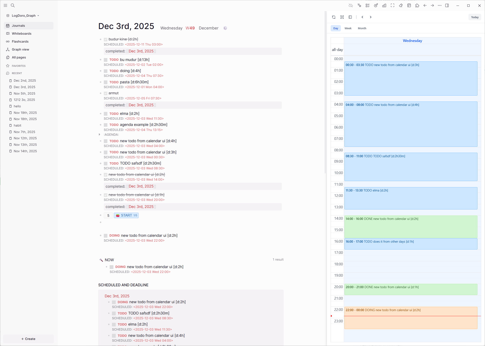
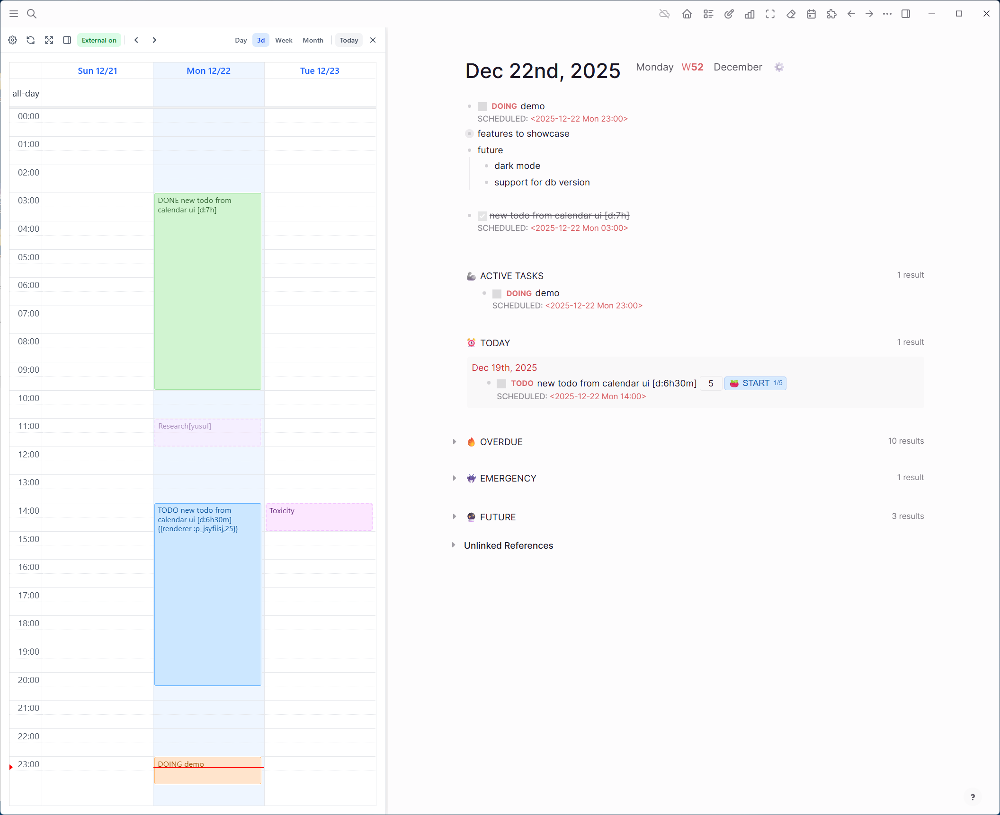
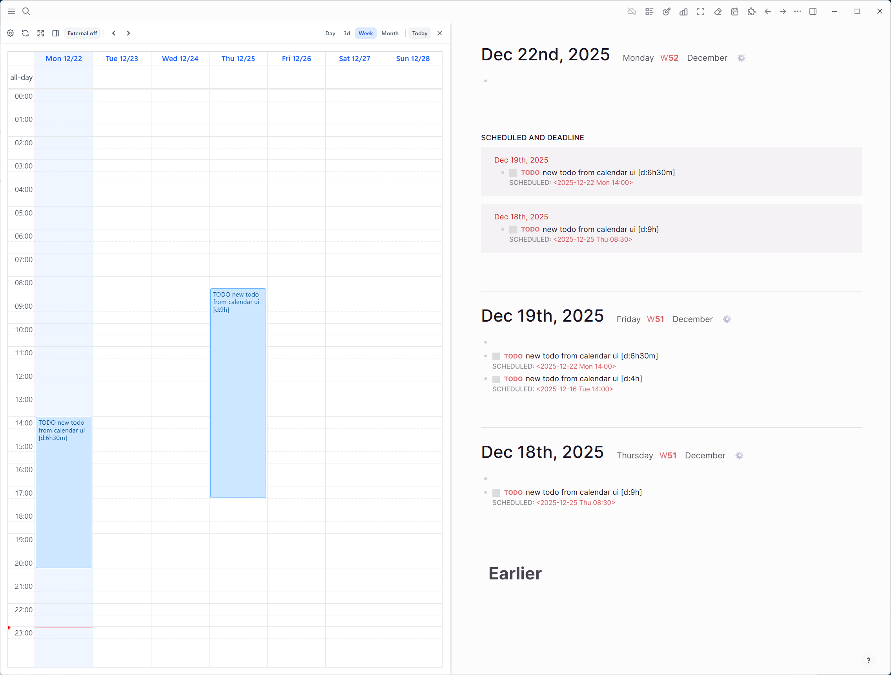
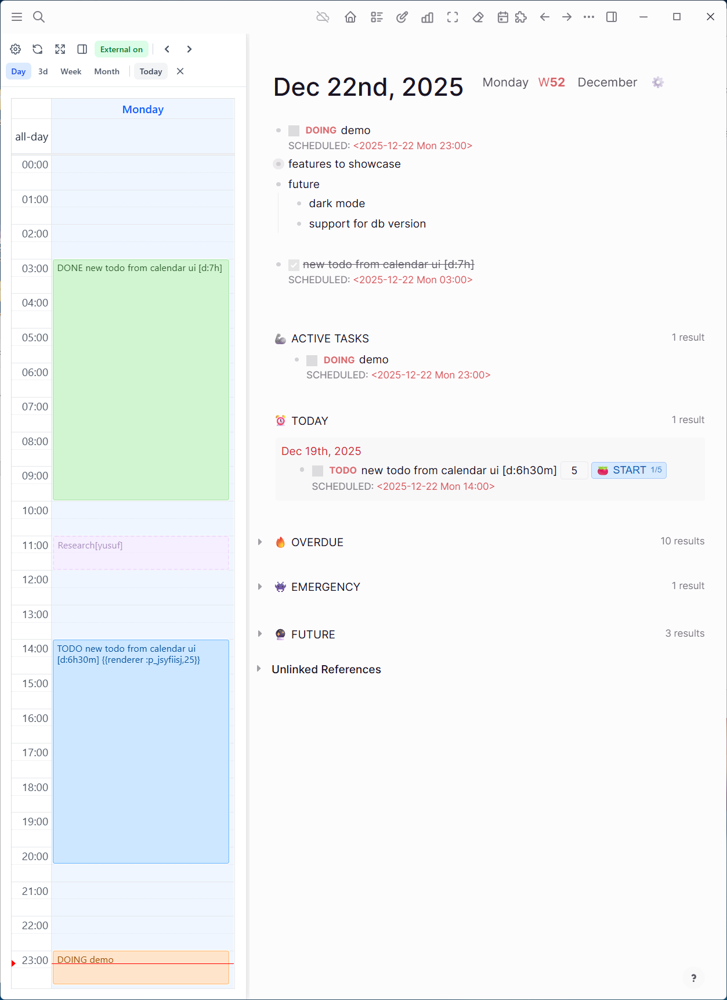
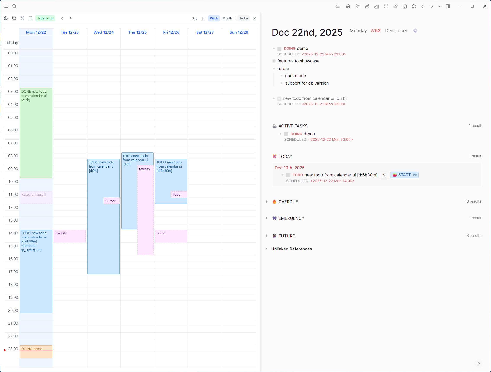

# Logseq Timebox

A calendar sidebar plugin for Logseq that lets you visualize and manage scheduled blocks in a timebox-style calendar view.

> Timebox supports both Markdown/file graphs (Logseq OG) and DB graphs (Logseq 2.x), including Marketplace installations. The active graph type is detected automatically; no compatibility setting is required.

## Layout and Logseq panels

The Timebox sidebar is drawn as a **fixed overlay** on top of the graph. It does **not** plug into Logseq’s built-in left/right **panel** layout, so the default sidebars stay **under** the calendar in stacking order and can be **covered** while Timebox is open.

**Workaround I prefer:** dock Timebox on the **left** and keep Logseq’s **left sidebar closed** when you want a clear calendar workspace. This stacking behavior is a **limitation of the plugin’s integration model**, not a bug in Logseq or Timebox.

## Features

- **Day/Week/Month/Multi-day Views** - Switch between different calendar views to plan your time (multi-day span is configurable)
- **Drag & Drop** - Drag a Logseq block by its bullet onto a calendar slot to schedule it, or move existing calendar tasks to reschedule them
- **Resize Events** - Adjust task duration by dragging the edges
- **Recurring Tasks** - Supports native recurrence in both graph types, including Markdown repeater patterns (`++1w`, `.+1d`, etc.)
- **Quick Create** - Click or drag on the calendar to create new scheduled tasks
- **Inline Edit** - Edit task titles directly from the calendar
- **Clear Schedule** - Remove scheduling from tasks with one click
- **External Calendars (ICS)** - Overlay read-only events from external feeds in both OG and DB graphs
- **Refresh** - Manually refresh events
- **Resizable Sidebar** - Drag to adjust the sidebar width
- **Left/Right Position** - Toggle sidebar position

## Later

- **Theme integration** - Seamless alignment with Logseq themes

## Screenshots

### General



### Demo


### More
<details>
<summary>More screenshots</summary>






</details>

## Installation

### From the Logseq Marketplace (recommended)

1. Open Logseq
2. Go to `...` → `Plugins` → `Marketplace`
3. Search for "Timebox"
4. Click `Install`

### Manual installation

1. Download the latest release from [Releases](https://github.com/yusuf8834/logseq-timebox/releases)
2. Unzip the file
3. In the Logseq desktop app, go to `...` → `Plugins` → `Load unpacked plugin`
4. Select the unzipped folder containing `package.json`

## Usage

1. Click the calendar icon in the toolbar to open the sidebar (the plugin remembers your last **view** and **date** between sessions)
2. Use the settings (gear) button to configure view and behavior preferences
3. **Switch views**: Use Day / Multi-day / Week / Month buttons (multi-day shows as `3d`, `4d`, etc.)
4. **Create tasks**: Click on a time slot or drag to select a time range
5. **Move tasks**: Drag and drop events to reschedule
6. **Resize tasks**: Drag the bottom edge of an event to change duration
7. **Edit tasks**: Click the pencil icon on an event (or set single/double click to `edit` in settings). By default, single click goes to the block and double click cycles status.
8. **Clear schedule**: Hover over an event and click the X button
9. **External calendars**: Toggle "External on/off" and use Refresh when needed
10. **Navigate**: Use the arrow buttons or "Today" to navigate dates

In Logseq OG/Markdown, drag a block's bullet from a page into the calendar to schedule that block in place. Timed slots assign a date and start time, keeping an existing duration or using one hour. Month cells and the all-day row assign only a date. The target slot highlights while you drag. Drop one block at a time; only the dragged block is scheduled, not its children or other selected blocks.

## Settings

Open settings via the gear icon in the toolbar or `...` → `Plugins` → `Settings`.

- **Start of day hour (0-23)**: Earliest hour shown in day/week/multi-day views
- **First day of week (0-6)**: 0 = Sunday, 1 = Monday, ... 6 = Saturday
- **Multi-day view length (days)**: Number of days shown in the multi-day view (min 2, max 14)
- **Default event duration (minutes)**: How long a scheduled task without a `[d:...]` token is drawn (min 5, max 480). Display only. Default: 60.
- **New task duration (minutes)**: Length of a task created by clicking an empty time slot (min 5, max 480). Dragging across slots uses the dragged length. Default: 30.
- **Snap interval (minutes)**: Step size for dragging, resizing and selecting in the time grid: `5`, `10`, `15` or `30`. Grid lines stay at 30 minutes. Default: `30`.
- **Single click action**: `none`, `edit`, `goto` (open block in Logseq), or `cycleStatus` (rotate Todo → Doing → Done using the active graph's native status values). Default: `goto`.
- **Double click action**: Same choices. Default: `cycleStatus` (Todo → Doing → Done → Todo; other statuses enter Doing first).
- **External calendar ICS URLs**: One URL per line (read-only overlays)
- **Show external calendars by default**: Initial visibility for ICS events

## Task format

Timebox displays blocks that have a **Scheduled** value. A **Deadline** without a Scheduled value is not added to the calendar. You can schedule blocks with Logseq's native commands or create them directly from Timebox.

### Markdown/file graphs (Logseq OG)

Markdown graphs use Logseq's timestamp syntax in the block text:

```
TODO My task [d:1h30m]
SCHEDULED: <2025-12-04 Thu 09:00>
```

- The `SCHEDULED` line is required. A task marker is optional; supported markers are `TODO`, `DOING`, `NOW`, `LATER`, `WAITING`, `DONE`, and `CANCELED`.
- Omit the time for an all-day block: `SCHEDULED: <2025-12-04 Thu>`.
- `[d:1h30m]` is Timebox's optional duration token. Resizing a timed event creates or updates it on the title line.
- Repeater patterns stay inside the scheduled timestamp and are preserved when an event is moved or resized, for example `SCHEDULED: <2025-12-04 Thu 09:00 ++1w>`.
- `[#A]` applies the high-priority color to open `TODO` and `LATER` tasks.

### DB graphs (Logseq 2.x)

DB graphs do not use the Markdown block format above. Add scheduling through Logseq's property UI or the `/Scheduled` command. Timebox uses these native properties:

| Property | How Timebox uses it |
| --- | --- |
| `Scheduled` | Required for the block to appear. A date-only value or a date/time at exactly 00:00 local time is treated as all-day; other times create timed events. |
| `Status` | Optional. Native statuses `Backlog`, `Todo`, `Doing`, `In Review`, `Done`, and `Canceled` control event styling. |
| `Priority` | Optional. `High` and `Urgent` use the high-priority color for open tasks. |
| `duration` | Optional plugin-owned number in minutes. Timebox creates or updates it when a timed event is created or resized. |

Timebox-created DB tasks are added to the selected date's journal with the `#Task` tag, `Status: Todo`, and a `Scheduled` value. Selecting a timed range also stores its duration. Existing blocks only need a `Scheduled` property to appear; `#Task` and `Status` are recommended but not required by Timebox.

Configure repeating DB tasks with Logseq's native **Repeat task** option in the Scheduled property editor. Timebox reads those structured recurrence settings and shows their repeat indicator. See [Logseq's DB task documentation](https://github.com/logseq/docs/blob/master/db-version.md#tasks) for the native task workflow.

## Development

```bash
# Install dependencies
pnpm install

# Development mode
pnpm run dev

# Build for production
pnpm run build
```

## License

MIT

## Contributing

Contributions are welcome! Please feel free to submit a Pull Request.

Contributor lists are for people only. Do not list AI tools, models, or agents
as contributors or add `Co-authored-by` commit trailers crediting them.
